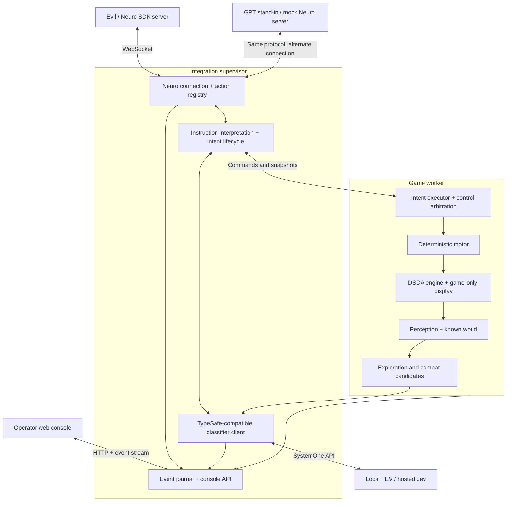

# Neuro-controlled Doom: architecture and implementation plan

Date: 2026-11-07

Status: proposed architecture; implementation has not begun. This document records
the agreed direction and implementation plan. Timing targets and defaults below
must be validated experimentally.

## Purpose and agreed roles

Evil gives persistent instructions covering exploration, combat, resources, and
progression. An internal classifier interprets those instructions against the
known game state. The existing Rust bot validates and executes them.

- **Commander:** Evil through the Neuro games SDK. For testing, a configurable GPT
  model acts as Evil through a mock Neuro server. This is an LLM role, not a Jev role.
- **Internal classifier:** local TEV or hosted Jev through a TypeSafe-compatible
  SystemOne interface. It interprets instructions and selects among feasible
  tactical or exploration choices. Hosted Jev is suitable for testing; measure
  its latency and quality separately from local TEV.
- **Executor:** deterministic Rust navigation, combat, and motor control at 35 Hz.
- **Operator console:** a separate web page showing the API interface, classifier
  decisions, bot state, and troubleshooting controls.
- **Stream output:** the game-only DSDA-rendered display, separate from the console.

Evil supplies natural language as an action argument. No speech transcription
integration is necessary. The game does not pause to wait for model responses.

## 1. Process architecture



| Component | Owns |
|---|---|
| Integration supervisor | Neuro connection, classifier requests, interpretation, operator API, logs, worker lifecycle |
| Game worker | DSDA, knowledge, navigation, combat, executable intent, 35 Hz simulation |
| Classifier service | Local TEV inference; hosted Jev substitutes through configuration |
| Browser console | Presentation and operator commands |
| Mock Evil server | GPT-based testing of the real integration interface |

The browser is optional at runtime. Closing it must not affect gameplay.

DSDA has a one-engine-per-process constraint (`native/src/engine.rs`). A worker
process isolates engine crashes and distinguishes restarting the game from
restarting the integration. The supervisor and console remain available during
worker recovery.

Use bounded local IPC for commands, events, and compact immutable snapshots.
Do not issue RPCs for each movement tic. Engine access remains on its owning
thread. Do not pass engine objects or navigation internals to network workers.
Specify framing, protocol version, startup handshake, and worker exit reporting.
If standard output carries IPC, send diagnostic text elsewhere.

## 2. Typed control boundary

The central object is a persistent `Intent`, not a raw string passed through every
subsystem:

```text
Intent
  id, revision, source, original instruction
  objective or bounded sequence of objectives
  resolved references
  hard constraints
  soft preferences
  permitted autonomous behavior
  completion and failure conditions
  scope and expiration
```

Example instruction:

> Explore the east side, pick up shells along the way, and don't leave the level.

Example interpretation:

```text
Objective: explore known eastern frontiers
Opportunistic pickups: shells, within a limited detour
Hard constraint: do not activate an exit
Combat: defend while maintaining exploration objective
Completion: no eligible eastern frontiers remain
```

Separate hard constraints from preferences:

- “Never use the BFG” prohibits BFG selection.
- “Prefer the shotgun” permits another weapon when justified.
- “Avoid fighting” changes engagement policy; document its self-defense default.
- “Stand still and don't fire” explicitly disables ordinary movement and firing
  assistance.

Do not silently reinterpret every instruction as “maximize survival.” Evil may
make bad decisions. Assistance operates within the command contract, including
explicitly permitted emergency behavior.

```text
received → interpreting → active
                          ↔ suspended
                          → completed / blocked / cancelled / superseded
```

Combat can suspend exploration without losing the destination. Resume the same
intent after the interruption. Define map-local and session-level policy scopes
explicitly so constraints do not accidentally survive or disappear on transitions.

## 3. Refactor the current bot around that boundary

Useful existing foundations are `native/src/play.rs`, `native/src/drive.rs`,
`native/src/knowledge/explorer.rs`, and `native/src/tactical/player.rs`.

| Existing area | Proposed change |
|---|---|
| `Agent` | Add directed mode using existing navigation and combat machinery |
| Explorer candidate generation | Produce inspectable options independently of selection |
| Explorer ranking | Return score components and reasons alongside ordering |
| Objective execution | Accept an explicit objective and intent constraints |
| Combat player | Separate tactical proposals from final control ownership |
| Drive commands | Consume shared inspection/control services |
| Replay | Record external decisions, settings changes, and application tics |

Retain the autonomous controller as a baseline and explicitly selectable mode.
A directed session must not silently complete the whole level when Evil stops
responding. Continue the current delegation, then use documented idle behavior.

## 4. Knowledge-filtered drive information

Create a `PerceivedWorld`; do not send raw engine observations to either model.
Include:

- Health, armor, ammunition, weapons, keys, and effects.
- Visible enemies and explicitly marked last-seen information.
- Discovered items, doors, switches, exits, and frontiers.
- Known route restrictions and observed hazards.
- Current objective, route progress, failures, and discoveries.
- Available exploration and tactical candidates.

Each candidate needs a stable ID, readable label, and supporting information:

```text
Objective: east passage
ID: map-7/frontier-18
Purpose: reveal unexplored area
Route: reachable through known corridor
Cost: moderate travel distance
Risk: crosses an exposed doorway
Alternative: nearby shell pickup
Recommendation: second choice; health pickup currently ranks higher
```

Use map-generation IDs, not positions such as “option 3.” Rankings change while
entity identity should remain stable. Resolve known aliases where unambiguous;
validate that references still exist and are actionable.

Distinguish observed facts, inferences, unknown information, and operator-only
ground truth. Unknown key locations remain unknown. Full-map routing, warping,
and other drive debugging powers are not part of Evil's normal action set.

## 5. Evil's action interface

Start with a small, expressive set:

| Action | Arguments | Purpose |
|---|---|---|
| `doom_direct` | `instruction`, optional `mode: replace/amend` | Exploration, combat, resource, or combined orders |
| `doom_inspect` | `topic`, optional `reference` | Objectives, routes, supplies, threats, orders, progress |
| `doom_choose` | `objective_id`, optional `instruction` | Select a known candidate precisely |
| `doom_cancel` | Optional `intent_id` | Cancel current or specified order |
| `doom_start` | Available scenario/map choice | Start a session |
| `doom_restart` | No required arguments | Restart when permitted |
| `doom_next_level` | No required arguments | Proceed from completion |

`doom_direct` is primary. For example:

> Find the blue key, conserve cells, and investigate that lift if it helps.

`doom_choose` avoids semantic target guessing when Evil already knows the desired
candidate. `doom_inspect` provides concise answers with relevant IDs and supports
follow-up inspection. It should not dump every internal field.

## 6. SDK lifecycle and acknowledgements

Keep schemas stable; change availability at lifecycle transitions:

| State | Available actions |
|---|---|
| Ready | Start, inspect |
| Playing | Direct, choose, inspect, cancel |
| Dead | Restart, inspect |
| Complete | Next level, restart, inspect |
| Loading/resetting | Inspect/status where appropriate |

Do not re-register target enums when enemies move or items disappear. Validate
references at execution time. The current SDK guidance favors stable registrations.

The adapter must implement:

- Text WebSocket messages, startup first, then current action registration.
- Both outer-message parsing and parsing of the action's JSON-string arguments.
- Validation independent of the advertised JSON schema.
- Duplicate action protection and cached results scoped to connection/session.
- Prompt success/failure results, including unknown or stale actions.
- At most one outstanding forced decision; no invented force-cancellation API.
- Reconnection, startup, re-registration, and compact current-state synchronization.
- Lifecycle registration diffs; remove disposable actions before acknowledging
  their transition where needed to avoid repeat-action races.

For natural-language orders, distinguish accepting an interpretation job from
accepting an executable plan:

1. Validate and enqueue the interpretation request.
2. Return “Instruction received; interpreting it.”
3. Keep the previous valid order active while interpretation runs.
4. Validate the interpretation against the current world.
5. Activate it and report the interpretation, or explain the ambiguity.

The action description must document this asynchronous contract. Receipt does
not mean understanding or completion. Send subsequent updates as context, not a
second terminal action result.

A later instruction invalidates older pending interpretations. Cancellation is
direct and does not wait for classification. A forced decision must never be a
dependency of immediate projectile avoidance. Define disconnected behavior as
bounded continuation of existing orders, not permission for new autonomous goals.

## 7. Classifier responsibilities

Use separate prompts, budgets, evaluation sets, and telemetry for two jobs.

### Instruction interpretation

- Determine objective category.
- Resolve references against known places and entities.
- Identify constraints and preferences.
- Determine replacement versus amendment.
- Detect ambiguity, unsupported requests, and conflicting requirements.

A classifier chooses among supplied answers; it is not a generator of arbitrary
plans. Define a supported intent vocabulary and bounded composition scheme.
Clarify unsupported or ambiguous instructions rather than inventing approximations.
Parse explicit numbers deterministically, validate all resolved fields together,
and include an unknown/none/clarification outcome where appropriate.

### Situational selection

- Choose exploration options within the current delegation.
- Choose among feasible combat plans.
- Evaluate permitted detours.
- Recommend suspension or reassessment when conditions change.

For combat, supply complete candidate maneuvers rather than independently choosing
target, weapon, and movement that may be incompatible. Examples:

- Move behind the left pillar to break the archvile's line of sight.
- Maintain distance and fire plasma at the archvile.
- Retreat along the known corridor.
- Hold fire to preserve an ongoing infight.

Rust generates feasible candidates, applies hard constraints, and revalidates the
selected result before execution. The model does not compute collision geometry
or issue raw movement commands.

Use a provider adapter for endpoint, model, credentials, timeouts, and capability
limits. TEV through Ollama and hosted Jev share the SystemOne request shape.
Keep prompts compact, record exact model/runtime versions, and benchmark both
TEV sizes against actual Doom cases. Confidence concentration is not correctness;
choose acceptance thresholds on held-out examples. Do not assume equal confidence
semantics or equal quality merely because APIs are compatible.

## 8. Scheduling and control ownership

Initial targets, subject to measurement:

| Activity | Schedule |
|---|---|
| Motor and immediate hazards | Every tic, 35 Hz |
| Combat classification | Event-triggered, initially capped around 2–5 Hz |
| Exploration selection | Completion, blockage, discovery, changed intent |
| Instruction interpretation | New instruction/amendment |
| Console snapshots | Approximately 5–10 Hz |
| Context to Evil | Meaningful changes and requested inspection |

Normally allow one tactical inference request in flight. Coalesce new observations
instead of accumulating a backlog. Keep interpretation and tactical scheduling
distinct so routine tactical requests do not starve new orders.

Correlate responses with:

```text
session generation
map generation
intent revision
candidate-set revision
observation tic
configuration revision
```

Discard results for old maps, superseded orders, expired observations, or invalid
candidates. Deadlines and freshness budgets are configurable and measured on the
target hardware. Timeouts keep deterministic execution/fallback running within
existing constraints; they never freeze simulation.

One arbiter owns movement, aiming, firing, and weapon switching. Represent weapon
and interaction commitments explicitly. The observed BFG regression is mandatory
coverage: navigation must not steal aim between attack start and projectile
launch. Releasing the trigger cannot cancel an already committed shot.

## 9. Web console

The console should answer: what did Evil request, what did the classifier choose,
what did the bot do, and why did they differ?

| View | Contents |
|---|---|
| Overview | Game status, health/ammo, instruction, objective/tactic, component health |
| Neuro interface | Messages, registrations, results, pending force, connection history |
| Interpretation | Original text, interpreted intent, references, constraints, ambiguity |
| Classifier | Requests, options, answers, distributions, latency, timeouts, stale rejection |
| Drive/exploration | Candidates, ranking factors, routes, known map, blocked objectives |
| Combat | Target, weapon, maneuver, cover, threats, control ownership |
| Timeline/replay | Correlated events, bookmarks, exports, run comparisons |
| Settings | Effective/pending values, validation errors, revision history |

Selecting an instruction filters to its classification, execution, and outcome.
Show recorded evidence and code selection reasons; do not fabricate model reasoning
when the model only returned a classification.

The console map can show known geometry, routes, and enemy memories. An explicitly
marked developer ground-truth view must not contaminate model-facing snapshots.
The game capture surface has no operator panels or diagnostic overlays.

Serve a bundled TypeScript application from the supervisor. Normal operation
should not require a separate frontend development server. Use HTTP for commands
and snapshots plus an event stream with sequence IDs and resynchronization.

## 10. Troubleshooting commands

| Control | Meaning |
|---|---|
| Reconnect Neuro | Replace connection, register actions, synchronize current state |
| Reconnect classifier | Recreate client and invalidate pending requests |
| Disable classifier | Deterministic fallback within current intent constraints |
| Restart level | Reset game and map knowledge; invalidate references/routes/decisions |
| Restart worker | Recover engine process while preserving console and logs |
| Cancel instruction | Use normal cancellation lifecycle |
| Pause/single-step | Explicit developer operation, never a model-wait mechanism |
| Inject instruction | Normal ingestion path, labeled operator-originated |
| Export diagnostic bundle | Relevant settings, events, decisions, replay |

By default a restart clears map-specific instructions. Carrying orders across a
reset is explicit. Every command has an ID and accepted/applied/failed states.
HTTP acceptance is not proof of game application.

Apply mutations through the worker command queue at a defined tic boundary. The
web server never mutates engine objects directly. Queue overload must be visible
and must not silently lose cancellation or reset commands.

Bind to localhost by default. Authenticate mutation requests, validate browser
origins, and keep API secrets server-side. Redact credentials from API views and
exported logs. Remote console access is a separately configured capability.

## 11. Live configuration

| Category | Examples |
|---|---|
| Live | Context frequency, telemetry detail, classifier cadence, tactical weights |
| Replan required | Search budget, exploration scoring, detour allowance |
| Connection replacement | Neuro URL, classifier endpoint, credentials |
| Level/worker restart | WAD, map, skill, engine compatibility |
| Fixed during run | Replay-sensitive engine settings |

For each change:

1. Validate ranges and cross-field constraints.
2. Show its application category.
3. Apply atomically as a configuration revision.
4. Invalidate affected plans or inference results.
5. Record the application tic.
6. Allow rollback to the previous revision.

Separate temporary changes from saving defaults. Expose curated, documented
parameters rather than every constant as an unexplained slider. Settings describe
units, defaults, bounds, and whether they affect reproducibility.

## 12. Events and reproducibility

Use typed events including:

```text
InstructionReceived
InterpretationCompleted
IntentActivated
ObjectiveSelected
ClassifierRequested
ClassifierReturned
ClassifierResultDiscarded
ControlOverride
ObjectiveBlocked
SettingsApplied
ConnectionChanged
LevelReset
```

Include sequence number, wall time, game tic where applicable, generation IDs,
and instruction/request correlation IDs.

Maintain bounded in-memory console history, an append-only run journal, periodic
snapshots, and per-tic control recordings with integration metadata. A slow browser
or journal consumer cannot block the game. Coalesce routine snapshots and report
dropped telemetry explicitly; identify runs with incomplete recordings.

Two replay modes:

- **Gameplay replay:** recorded controls, no model calls.
- **Decision replay:** recorded observations/instructions evaluated by another
  model or controller for comparison.

Exact gameplay reproduction must not require the same model response a second
time. Record engine/WAD identity, seed, code version, settings revisions, prompts,
model version, selected answers, and their application order.

## 13. Proposed code organization

```text
native/src/
  control/
    intent.rs
    lifecycle.rs
    executor.rs
    arbitration.rs
    commitments.rs
  perception/
    snapshot.rs
    references.rs
    summaries.rs
  exploration/
    candidates.rs
    evaluation.rs
    execution.rs
  tactical/
    ...existing combat machinery...
  protocol/
    commands.rs
    events.rs
    snapshots.rs
    configuration.rs

integration/
  supervisor/
  neuro/
  classifier/
  console_api/
  mock_neuro/

console/
  src/
    overview/
    neuro/
    decisions/
    exploration/
    combat/
    settings/
    timeline/
```

Choose exact crate boundaries during implementation. Navigation and combat must
not depend on HTTP, Neuro messages, or browser components. Share versioned DTOs
between the worker and supervisor; avoid duplicating domain rules in the UI.

The historical `docs/DECISIONS.md` needs reconciliation: its Python/ViZDoom-first
topology and rapidly changing action enums no longer describe the intended
Rust/DSDA architecture. Preserve historical findings while documenting superseded
decisions explicitly.

## 14. Implementation stages and acceptance gates

| Stage | Deliverable | Gate |
|---|---|---|
| 1. Control boundary | Intents, snapshots, directed mode, arbitration | Autonomous baseline survives refactor; direct orders constrain execution |
| 2. Supervisor/console | Worker management, journal, overview, reset, settings | Console survives worker failure; browser disconnect cannot affect gameplay |
| 3. Neuro adapter | Stable lifecycle, actions, reconnect | Scripted malformed/stale/duplicate-action protocol tests pass |
| 4. GPT stand-in | Mock Neuro server with configurable GPT commander | Uses actual SDK adapter, changing availability, delayed responses |
| 5. Interpretation | Jev/TEV shadow evaluation, then activation | Held-out instruction tests pass before activation |
| 6. Tactical assistance | Exploration/combat selection | Measured benefit without instruction-compliance regression |
| 7. Stream rehearsal | Game-only capture, console, recovery | Extended runs tolerate connection/inference failures without hidden pauses |

First milestone: a directed bot with `doom_direct`, `doom_inspect`, a basic console,
and a scripted commander. Establish control contracts and observability before
adding the GPT stand-in and classifier.

### Validation matrix

- Instructions: negation, amendments, multiple clauses, ambiguous references,
  impossible requests, conflicting constraints, unsupported plans.
- SDK: malformed nested JSON, duplicate IDs, stale actions, reconnects, pending
  forces, changes in action availability, result-versus-completion semantics.
- Lifecycle: death during inference, reset during inference, worker crash,
  superseding instructions, API loss during execution, console reconnect.
- Control: BFG launch commitment, exploration resumption after combat, exit
  prohibition, weapon constraints, bounded detours, cancellation.
- Performance: tic budget, inference p50/p95/p99, candidate generation overhead,
  GPU contention, browser/log backpressure, request queue bounds.
- Replay: reproduce controls without model calls; settings and external decisions
  applied at recorded tics; disclose incomplete logs.

Use existing combat arenas and real-map scenarios, plus exploration fixtures.
Compare hosted Jev and local TEV with identical recorded inputs, live runs at actual
latencies, and controlled added-delay experiments to separate quality from speed.
Evaluate held-out cases and seeds, not only demonstrations used to tune prompts.

Measure instruction fidelity, survival, damage, ammunition waste, objective time,
unnecessary detours, target switching, stale responses, fallback frequency,
recovery behavior, and operator visibility. Winning alone is insufficient.

## Primary references

Checked while preparing this plan on 2026-11-07. Pin and recheck protocol/runtime
versions when implementing.

- [Neuro API specification](https://github.com/VedalAI/neuro-sdk/blob/main/API/SPECIFICATION.md)
- [Neuro integration best practices](https://github.com/VedalAI/neuro-sdk/blob/main/API/BEST_PRACTICES.md)
- [TEV in Ollama and the SystemOne interface](https://ollama.com/library/tev1)
- [Together TEV repository](https://github.com/togethercomputer/tev1)
- [TypeSafe Choice documentation](https://docs.typesafe.ai/primitives/choice)
- [TypeSafe confidence documentation](https://docs.typesafe.ai/confidence)
