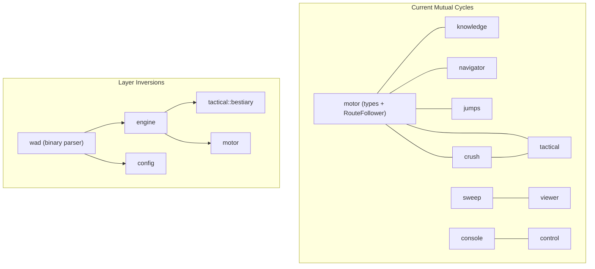
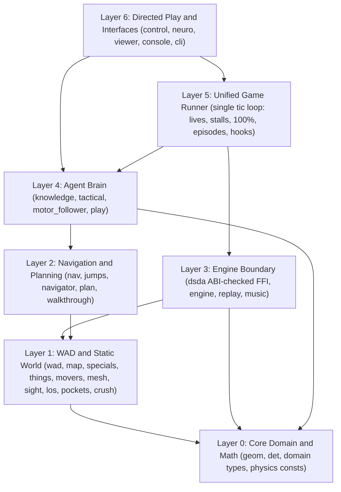

# Evil BOOM — Comprehensive Code Review & Restructuring Plan

> **Status:** proposed (2026-11-21); reviewed against the code the same day. Each finding
> carries a **Reviewed** line saying what was confirmed, regraded or struck, and the phases
> are as amended by that review. See [What the review changed](#what-the-review-changed).

**Scope:** Full repository audit across `native/` (140 Rust files, 78,147 LOC), `dsda/` (`evil_api.c` + `dsda-doom.patch`), `tools/`, `config/`, and `.github/workflows/`.

---

## Executive Summary

Evil BOOM is an impressively disciplined, domain-rich codebase in several important ways:

- **Zero `#[allow]` attributes** across 78k LOC; Clippy `-D warnings` and `rustfmt` enforced in CI.
- **Strict `unsafe` containment**: all 119 lines referencing `unsafe` live inside [`native/src/dsda.rs`](../../native/src/dsda.rs).
- **Zero non-test `panic!()` or `.unwrap()` calls** (only 8 documented `.expect()` calls across 78k LOC).
- **100% SPDX header compliance** across all Rust source files and a clean DOM-only web console (`page.html` has zero `innerHTML`/`eval` sinks).
- **Strong empirical engineering culture**: deterministic seeds, `tools/parity.sh` for zero-drift refactors, and `tools/lives/run.sh` for gameplay measurement.

However, the codebase **nearly doubled in size in 10 days** (from 43.8k LOC in [`cleanup-2026-11.md`](cleanup-2026-11.md) to **78.1k LOC** today) as Directed Play, Neuro SDK, Stream Presentation, and the Web Console landed rapidly on top of the core bot. That rapid growth left **real safety/concurrency/security bugs**, **8 mutual module dependency cycles**, **4 mega-files exceeding 2,700–3,460 lines**, **four duplicated game loops**, **pervasive stringly-typed domain logic** (blocking MBF21 / custom PWAD upgradability), and a **severe unit-test deficit** (64 tests total across 78k LOC).

> [!IMPORTANT]
> In keeping with [`CONTRIBUTING.md`](../../CONTRIBUTING.md), this plan strictly separates **Tier 1 bug/security/UB fixes**, **behavior-preserving structural refactors** (verified with `tools/parity.sh`), and **behavior-changing or feature-enabling upgrades** (measured individually with `tools/lives/run.sh`).

---

## What the review changed

The findings were checked against `origin/main` at `7cc5811`. Most stand; the grading and
the order of work changed.

- **Regraded down:** C4 (the console: it binds to localhost unless told otherwise, and most
  items need the tunnel or a local attacker to matter) and H2 (stale counters: part of it may
  be meant, and mending it changes play).
- **Struck as wrong:** the `build.rs` staleness claim in H6 (it already watches `.git/index`,
  which every commit changes, and Cargo scans a watched directory through its
  subdirectories) and the blockmap `i16` claim in H5 (a blockmap can't have more than a few
  hundred columns or rows in Doom's coordinate space).
- **Narrowed:** C1 (one path, `watch --gpt`), H1 (`arena` can hang today, `sweep` can't),
  the hasher in M4 (keep the algorithm, or don't touch it).
- **Sequencing added:** the `ultra-instinct` branch adds about 470 lines to `viewer.rs`,
  inside the watcher's loop. Unifying the game loops (Phase 2) and splitting `viewer.rs`
  (Phase 3) wait until that branch is merged or dropped.
- **A check added:** `tools/parity.sh` plays the sweep's path only. It can't show that
  `watch`, `record` and the headless watcher still play as they did, so the loop
  unification needs a check that plays one run each way and compares them, written first.
  (On 2026-11-21 a windowed run with the ultra instinct parted from the headless run of the
  same seed: the loops differ in ways that matter.)
- **Dropped:** the per-sector `SectorKnowledge` record (Phase 3), the 800-line target as a
  goal in itself, the workspace split for now, and a shared process pool built round the
  retired `score`.
- **Tests:** for invariants (rocket safety, the WAD parser, the console's checks), not for
  the fight tree's priorities, which change weekly and are judged by the three-lives test.

### Done so far

- **Phase 0** (2026-11-21): CI lints and tests the build with no window; `build-engine.sh`
  checks the pinned commit and refuses a tree changed by something else; `build.rs` reads
  `fix` from its own section. Left: `shellcheck` (not installed where this was done, so
  what it would flag is unknown), `-Wall -Wextra` on the bridge, Freedoom in CI.
- **Phase 3, the files split** (2026-11-21): each of the four moved as it was into modules
  under it, checked by `tools/parity.sh`, `tools/eachway.sh`, the arenas and (directed
  play) one script played on the build before and after:
  `viewer.rs` 3,288 lines to 1,676 (`canvas`, `draw`, `record`, `instinct`);
  `tactical/player.rs` 3,460 to 1,600 (`retreats`, `cover`, `going`, `errands`, `stocking`,
  `advice`); `control/directed.rs` 3,146 to 1,478 (`news`, `listings`, `tactics`,
  `instinct`, `orders`, `open`); `tactical/combat.rs` 3,127 to 1,212 (`seeing`, `hearing`,
  `memory`, `leaving`, `firing`, `metrics`, `counts`).
  **Left, each a change to what the code says and not to where it is, so each its own
  commit with its own check:** the retreats' three matches as one table; the three ways of
  holding fire as one; `size_up` changing nothing before the tree decides; `Policy`'s
  settings as enums; the follower's three longest functions cut into steps; the `Agent`'s
  fields behind methods. Dropped as before: the per-sector record.
- **Phase 2.2, as far as it's gone** (2026-11-21): the check it waited on is
  `tools/eachway.sh` (the same 24 runs by `run-map` and by the watcher with no window,
  compared). Its first run found two real faults, both mended: the watcher's map listed her
  options afresh each second, which changed what she did next (a watched run wasn't the run
  measured), and a level's first run in a fresh folder played on jumps a last bit off from
  the ones every later run read back. The watcher's three loops already share a tic
  (`Watch::tic`); they now share a death too (`Watch::died`: the watcher with no window and
  the recorder, which had ignored `--lives`). The sweep and the watcher share `run.rs` (the
  options, the setting up, the 100% sums, a secret found).
  **Left, and why:** one loop under both. On one life the two play the same tics already,
  and the check holds them to it. Where they differ they differ on purpose: the sweep begins
  the level again when she's stranded and stops at a stall, which a test wants; the watcher
  does neither, because there the level again is Evil's to ask for. Folding them into one
  means a `Session` that is the watcher's `Watch` without its window, its stream and its
  console, which is also the splitting of `viewer.rs` (Phase 3.4), with the life rules as a
  setting. It touches everything streamed, and what's streamed (the window, the stream's
  column, the console, Neuro) can't be seen or tried where this was done. For the
  maintainer to do, or to watch being done.
- **Phase 2.3** (2026-11-21): unknown options are refused by every command (Phase 1). The
  nine parsers weren't rewritten over `lexopt`: with that fault gone it's churn for its own
  sake. `score.rs` and `tools/score/` are still there: removing them is the maintainer's
  word to give.
- **Phase 2.1** (2026-11-21): `domain.rs` holds a tic's observation and controls, the
  things and sounds in it, the game's constants of time and movement, her turn limits and
  the risk share; `bestiary.rs` is a module of its own, not the fight's (the engine and the
  follower read it); `episode_map` is `map.rs`'s; `CONSOLE_NAME` is the console's; a
  geometry helper is `geom.rs`'s; a run's options, its setting up and what every way of
  running her goes by are `run.rs`, under the sweep, the watcher and the ultra instinct's
  runner alike. No two top-level modules depend on each other now (there were eight pairs),
  and `tools/dev/cycles.py`, run in CI, keeps it so. A barrel's size and its blast's reach
  are said once. `wad` still reads `config::pwads()`.
- **Phase 1** (2026-11-21): C3 (the ABI check, and no `transmute` left in `dsda.rs`), H1
  (`arena`), C1, C2, H6 (the progress line, unknown options), H3, H4, H5 (with the first
  tests CI can run without IWADs), C4 (all but ending the game on Ctrl-C, which needs a
  signal handler: a dependency, or unsafe code outside `dsda.rs`). H2 was looked at and
  left: hits and sounds are read every tic, so none are left over at a restart, the
  warm-up's sounds did happen, and the pellets are a count "so far" on purpose. `record`
  ignoring `--lives` (H6) goes with the one game loop.

---

## Codebase Health Snapshot

| Metric | Value | Assessment |
|---|---:|---|
| Rust source files / lines | 140 files / 78,147 LOC | 25 files > 1,000 LOC; top 4 files are 2,790–3,460 LOC |
| C boundary (`dsda/`) | 1,140 LOC (`evil_api.c`) + 460-line patch | Compact patch, but lacks ABI versioning & thread sync |
| `unsafe` / `#[allow]` / non-test `.expect()` | 119 (all in `dsda.rs`) / 0 / 8 | Strong hygiene |
| Unit + integration tests | 64 `#[test]` functions (~0.8 / kLOC) | Critical gap: combat, follower, planner, explorer mostly untested in isolation |
| Mutual 2-node module cycles | 8 cycles | Blocks crate/workspace splitting and clean testing |
| Duplicated game loops | 4 (`sweep`, `watch`, `record`, `headless`) | Behavioral drift already visible (e.g., `record` ignores `lives_left`) |
| Monster/thing string literals | 144+ occurrences + 10 `.category ==` checks | Blocks MBF21 / DeHackEd / custom PWAD extensibility |

### Subsystem Weight Breakdown

| Subsystem | Files | Lines | Key Monoliths |
|---|---:|---:|---|
| `tactical/` | 22 | 15,001 | [`player.rs`](../../native/src/tactical/player.rs) (3,460), [`combat.rs`](../../native/src/tactical/combat.rs) (3,127), [`tree.rs`](../../native/src/tactical/combat/tree.rs) (1,102), [`boss.rs`](../../native/src/tactical/player/boss.rs) (1,095) |
| `knowledge/` | 16 | 11,122 | [`objectives.rs`](../../native/src/knowledge/explorer/objectives.rs) (1,620), [`routing.rs`](../../native/src/knowledge/explorer/routing.rs) (1,432), [`explorer.rs`](../../native/src/knowledge/explorer.rs) (1,298), [`selection.rs`](../../native/src/knowledge/explorer/selection.rs) (1,183) |
| `control/` | 19 | 7,824 | [`directed.rs`](../../native/src/control/directed.rs) (3,146), [`ask.rs`](../../native/src/control/directed/ask.rs) (905) |
| `motor/` | 10 | 7,195 | [`follower.rs`](../../native/src/motor/follower.rs) (1,393), [`interactions.rs`](../../native/src/motor/follower/interactions.rs) (1,272), [`walking.rs`](../../native/src/motor/follower/walking.rs) (1,181) |
| `navigator/` + `nav/` + `plan/` + `jumps/` | 19 | 12,577 | [`fit.rs`](../../native/src/nav/fit.rs) (1,258), [`view.rs`](../../native/src/navigator/view.rs) (1,110), [`navigator.rs`](../../native/src/navigator.rs) (1,068), [`physics.rs`](../../native/src/jumps/physics.rs) (1,046) |
| `viewer/` | 6 | 4,975 | [`viewer.rs`](../../native/src/viewer.rs) (2,790), [`stream.rs`](../../native/src/viewer/stream.rs) (830) |
| `neuro/` | 6 | 2,614 | [`session.rs`](../../native/src/neuro/session.rs) (1,416), [`gpt.rs`](../../native/src/neuro/gpt.rs) (581) |
| `console/` | 3 + HTML | 1,910 + 63KB | [`server.rs`](../../native/src/console/server.rs) (1,429), [`page.html`](../../native/src/console/page.html) |
| CLI, runners, FFI | 7 | 6,625 | [`sweep.rs`](../../native/src/sweep.rs) (1,364), [`main.rs`](../../native/src/main.rs) (1,302), [`dsda.rs`](../../native/src/dsda.rs) (1,288), [`score.rs`](../../native/src/score.rs) (1,001) |

---

## Part 1: Concrete Findings by Severity

### Critical — Safety, Concurrency, UB & Security

#### C1. Multithreaded `std::env::set_var` / `remove_var` (POSIX UB, Rust 2024 blocker)
- **Where:** [`native/src/main.rs:653-668`](../../native/src/main.rs#L653-L668), [`native/src/engine.rs:116-132`](../../native/src/engine.rs#L116-L132), [`native/src/engine.rs:637-641`](../../native/src/engine.rs#L637-L641), [`native/src/config.rs:78-83`](../../native/src/config.rs#L78-L83).
- **Issue:** In `watch()`, `neuro::gpt::start()` spawns a background thread at line 655 (which runs HTTP/DNS/TLS and reads env vars); *after* spawning that thread, line 666 calls `std::env::set_var("SDL_NO_SIGNAL_HANDLERS", "1")` and `Engine::new()` mutates `DOOMWADDIR`, `DOOMDATADIR`, `SDL_AUDIODRIVER`, and `SDL_VIDEODRIVER`. Concurrent `setenv`/`getenv` is undefined behavior on Linux/POSIX (can crash in libc/DNS/TLS) and is `unsafe` in Rust 2024.
- **Fix:** Pass SDL driver hints via `SDL_SetHint` inside `evil_init` (before `I_PreInitGraphics`) or compute and set all process env vars once in single-threaded `main()` *before* spawning `neuro::gpt` or console/viewer threads.
- **Reviewed: confirmed, narrow.** Only `watch --gpt` has a thread alive when the variables are set (`neuro::gpt::start` at `main.rs:655`, then `SDL_NO_SIGNAL_HANDLERS` and `Engine::new`'s four). `EVILBOOM_PWADS` is already set while the process is one thread, and says so: threading PWADs through `RunOptions` isn't needed for this. The mend is to set them all above the spawn.

#### C2. C Data Races and Use-After-Free Hazard Across the DSDA FFI Boundary
- **Where:**
  - [`dsda/dsda-doom.patch:36-50`](../../dsda/dsda-doom.patch#L36-L50): `evil_master_volume` is a plain `int` written by `evil_volume()` on the main thread and read concurrently in SDL's audio callback thread (`I_UpdateSound`).
  - [`dsda/evil_api.c:757-814`](../../dsda/evil_api.c#L757-L814): `evil_event_filter()` mutates `evil_events` and `evil_event_count` without a mutex/spinlock, even though SDL documents that `SDL_SetEventFilter` callbacks may be invoked from arbitrary threads.
  - [`native/src/dsda.rs:304-319`](../../native/src/dsda.rs#L304-L319): `_lib` is `ManuallyDrop<Library>` (explicitly so background SDL threads don't jump into unmapped code on drop), **but `_argv` and `_argv_ptrs` are NOT `ManuallyDrop`**. If `Dsda` is dropped while the process is still alive (e.g., error unwinding or cleanup), DSDA's C globals retain dangling pointers into freed `CString`s.
  - [`native/src/dsda.rs:326-330`](../../native/src/dsda.rs#L326-L330): `LOADED.swap(true, SeqCst)` is never rolled back if `open_library()` or symbol resolution fails.
- **Fix:**
  - Use `SDL_AtomicSet`/`SDL_AtomicGet` for `evil_master_volume` and an `SDL_SpinLock` (or `SDL_mutex`) around `evil_events`/`evil_event_count`.
  - Wrap `_argv` and `_argv_ptrs` in `ManuallyDrop` alongside `_lib` (or leak them intentionally once per process).
  - Only flip `LOADED` to `true` after `evil_init` succeeds (or reset on error via a guard).
- **Reviewed: confirmed, low risk, cheap.** `_argv` beside a never-unloaded `_lib` is the real one. The volume `int` and the event filter are races in form, mended for tidiness.

#### C3. Zero Runtime ABI Verification Across `evil_api.c` ↔ `dsda.rs`
- **Where:** [`native/src/dsda.rs:19-96`](../../native/src/dsda.rs#L19-L96), [`native/src/dsda.rs:337-494`](../../native/src/dsda.rs#L337-L494), [`dsda/evil_api.c:71-116`](../../dsda/evil_api.c#L71-L116).
- **Issue:** `dsda.rs` resolves ~35 symbols via raw `std::mem::transmute::<*const (), FnType>` with 25+ `Option<...Fn>` fields for backwards compatibility with older builds of `libdsda-evil`. Yet there is **no ABI version or struct-size handshake**. If a field is added/reordered in `evil_mobj`, `evil_player`, or `evil_status` without rebuilding the engine, Rust silently corrupts stack memory or reads garbage. (Notably, [`rust-review.md`](rust-review.md) documented that `dsda/spike` had already suffered this exact struct-size drift.)
- **Fix:**
  - Export `EVIL_API int evil_abi_info(int *out)` returning `(ABI_VERSION, sizeof(evil_mobj), sizeof(evil_player), sizeof(evil_status))` and verify all four on `Dsda::load()` before calling `evil_init()`.
  - Replace all `std::mem::transmute::<*const (), FnType>` calls with a small typed helper calling `lib.get::<T>(name)` directly (zero `transmute`).
  - Consolidate optional legacy shims once `ABI_VERSION` is enforced.
- **Reviewed: confirmed (42 `transmute`s, no handshake); first in Phase 1.** Side builds of the program are run against the one engine library in `third_party` every day here, so a mismatch is a live hazard, not a theoretical one.

#### C4. Web Console Security & Availability (`console/server.rs`) — regraded to Medium
- **Where:** [`native/src/console/server.rs`](../../native/src/console/server.rs).
- **Issues:**
  1. **Non-cryptographic auth token** ([L576-L590](../../native/src/console/server.rs#L576-L590)): `new_token()` hashes timestamps/PID with `RandomState` (SipHash-1-3 — explicitly not a CSPRNG).
  2. **Single-threaded blocking HTTP loop** ([L558-L560](../../native/src/console/server.rs#L558-L560), [L998-L1004](../../native/src/console/server.rs#L998-L1004)): `server.incoming_requests()` handles requests sequentially with no read timeout. One stalled client blocks the entire console server indefinitely (DoS).
  3. **Open redirect in 308 handler** ([L967-L978](../../native/src/console/server.rs#L967-L978)): A request to `//attacker.example` produces `Location: //attacker.example/`.
  4. **Parameter injection in `evil_maps`** ([L184-L263](../../native/src/console/server.rs#L184-L263), [L347-L363](../../native/src/console/server.rs#L347-L363)): `Settings::check()` validates `wad`, `map`, `evil_skills`, and `evil_play`, but **never validates `evil_maps`** before interpolating it into `--choices "maps={maps};..."`. A `;` inside `evil_maps` injects arbitrary choice parameters.
  5. **Secret token file permissions & non-atomic writes** ([L471](../../native/src/console/server.rs#L471)): `config/console.local.json` is written directly with default umask (`0644` world-readable on Linux) and without temp-file + rename (unlike `music.rs:175`). A crash mid-write breaks future startups.
  6. **Auth token in URL query string** ([L550](../../native/src/console/server.rs#L550), [`page.html:371`](../../native/src/console/page.html#L371)): Leaks into browser history, proxy logs, and `Referer` headers.
  7. **Local TCP control link authenticated only by PID** ([L629](../../native/src/console/server.rs#L629)): Any local process can read the child's PID and beat it to `Hello` during the multi-second map analysis window.
  8. **Spoofable audit header** ([L990-L996](../../native/src/console/server.rs#L990-L996)): `Cf-Access-Authenticated-User-Email` is trusted from any peer (not restricted to loopback/configured reverse proxy).
- **Fix:** Generate tokens from OS CSPRNG (`getrandom`), use a bounded worker thread pool for HTTP requests, sanitize redirect paths (reject leading `//`), validate `evil_maps` against `all` or valid map names, write `console.local.json` atomically with `0600` permissions on Unix, pass a per-launch random nonce on the control link, and migrate API calls to `X-Evil-Token` header (stripping `?t=` from the URL via `history.replaceState` after initial load).
- **Reviewed: regraded.** The console binds to localhost unless told otherwise; 2, 3 and 8 matter only behind the tunnel. Item by item:
  1. True in form, fine in practice: `RandomState`'s keys are from the system's randomness and the token can't be guessed. Last.
  2. Confirmed.
  3. Confirmed: one line.
  4. Confirmed, but only the console's own user, who chooses every one of those settings anyway, can inject. Hygiene.
  5. Confirmed, cheap.
  6. As designed (it's the link the console prints). The header is a nicety.
  7. Confirmed; a nonce is cheap.
  8. Confirmed, but the header only names who's asking in the log; nothing is allowed by it.

---

### High — Correctness Bugs, Deadlocks & Resource Leaks

#### H1. Subprocess Pipe Deadlock in `arena` and `sweep`
- **Where:** [`native/src/main.rs:580-605`](../../native/src/main.rs#L580-L605) (`sweep`) and [`native/src/main.rs:1066-1090`](../../native/src/main.rs#L1066-L1090) (`arena`).
- **Issue:** Both commands spawn children with `Stdio::piped()` (and `arena` pipes *both* `stdout` and `stderr`), then poll `child.try_wait()` until the child exits *before* draining either pipe. Any child that prints more than the OS pipe buffer (~4 KB on Windows, ~64 KB on Linux — e.g., when a debug switch is enabled or DSDA prints verbose errors) **deadlocks permanently**. Note that [`native/src/score.rs:433-438`](../../native/src/score.rs#L433-L438) already ran into this exact bug for `stderr` and worked around it with a file, while `arena` and `sweep` still have it.
- **Fix:** Drain the pipes while the child runs (a thread a child, or `Command::output()`), in `arena` first.
- **Reviewed: confirmed, latent.** `arena` pipes stderr, so a debug switch can hang it today. `sweep` sends stderr to nothing and its stdout is a few lines: safe as it stands. Not a shared pool for all four: `score` is retired and is for deleting, not refactoring.

#### H2. Stale Engine State Across Restarts (`evil_sounds`, `evil_hits`, `evil_pellets`)
- **Where:** [`dsda/evil_api.c:209-224`](../../dsda/evil_api.c#L209-L224), [`dsda/dsda-doom.patch:229-234`](../../dsda/dsda-doom.patch#L229-L234), [`native/src/engine.rs:272-293`](../../native/src/engine.rs#L272-L293).
- **Issue:** `evil_new_game()` does not reset `evil_sounds_read`/`evil_sound_count`, `evil_hits_read`/`evil_hit_count`, or `evil_pellets[7]`. In `Engine::new_game()`, `WARMUP_TICS` tics run without draining `sounds()` or `hits()`. Consequently, sounds/hits from the end of a previous life or level can bleed into the first `observe()` of the new life/level, and `evil_pellets` accumulates across levels in an episode.
- **Fix:** Reset `evil_sounds_read = evil_sound_count`, `evil_hits_read = evil_hit_count`, and `memset(evil_pellets, 0, sizeof evil_pellets)` in `evil_new_game()` (keeping parity check in mind if any existing run depends on warmup sounds).
- **Reviewed: partly, regraded to Low; check what's meant first.** `evil_new_game` resets none of them, true. But the pellets are documented as "so far" and may be meant to run on, and a sound made in the warm-up tics did happen. Resetting changes play, so it costs a three-lives test for little.

#### H3. Unbounded Memory Queue in Console Preview Encoder (`viewer/console.rs`)
- **Where:** [`native/src/viewer/console.rs:50-72`](../../native/src/viewer/console.rs#L50-L72).
- **Issue:** `channel::<Picture>()` is unbounded. Each `Picture::Rgb` is up to ~2–4 MB. If PNG encoding or the TCP link backs up, frames accumulate without limit.
- **Fix:** Use a 1-slot `Mutex<Option<Picture>>` + `Condvar` (or `sync_channel(1)` with `try_send`) so stale preview frames are dropped rather than queued.
- **Reviewed: confirmed.**

#### H4. WebSocket Thread Leak (`neuro/link.rs`) & Fragile Server Accept (`neuro/gpt.rs`)
- **Where:**
  - [`native/src/neuro/link.rs:83-91`](../../native/src/neuro/link.rs#L83-L91): If `ws.send(startup)` succeeds and `incoming.send(Connected)` fails (receiver dropped), `run()` falls out of the `if`, sleeps 2s, and loops forever as a zombie thread.
  - [`native/src/neuro/gpt.rs:196-202`](../../native/src/neuro/gpt.rs#L196-L202): `tungstenite::accept(stream)?` aborts the entire `neuro-gpt` server on a single failed/non-WS TCP connection (e.g., port probe or accidental browser hit) instead of logging and continuing.
  - [`native/src/console/server.rs:1053-1061`](../../native/src/console/server.rs#L1053-L1061): Rapid clicks on `/api/game/restart` spawn competing uncoordinated threads calling `stop(); start();`. Also, `evil-boom console` has no Ctrl-C/shutdown cleanup to terminate the child `watch` process.
- **Fix:** Check `incoming.send()` errors consistently to exit `Link::run`; `continue` on `accept` errors in `neuro/gpt.rs`; serialize game lifecycle transitions (`start`/`stop`/`restart`) through a single supervisor actor/channel in `console/server.rs` with graceful child teardown on `SIGINT`/`SIGTERM`.
- **Reviewed: confirmed, minor.** The `neuro-gpt` one first: a port probe ends the stand-in. The reconnecting thread needs the receiver dropped with the process still alive, which doesn't seem to happen.

#### H5. Malformed / Community PWAD Parsing Panics (`wad.rs`)
- **Where:** [`native/src/wad.rs:72-96`](../../native/src/wad.rs#L72-L96), [`native/src/wad.rs:146-185`](../../native/src/wad.rs#L146-L185), [`native/src/wad.rs:250-260`](../../native/src/wad.rs#L250-L260).
- **Issues:**
  - `Vec::with_capacity(count)` trusts the WAD header `count` before checking `dir + 16 * count <= data.len()` (can OOM-panic on corrupt WADs).
  - Unchecked arithmetic (`dir + 16 * i`, `lump.offset + lump.size`, `4 + 4 * i`, `columns * rows`).
  - `load_map()` does not validate vertex/sidedef/sector indices before returning `MapData`, causing downstream index panics on malformed PWADs.
- **Fix:** Use checked arithmetic throughout `wad.rs`, validate directory bounds before allocating, and validate all linedef/sidedef/seg/subsector indices in `load_map()`.
- **Reviewed: mostly confirmed.** `with_capacity(count)` before the bounds check is real. Struck: the claim that reading the blockmap's columns and rows as `i16` fails on large maps (a column is 128 units and the coordinate space 65,536 across: a few hundred at most). The index checks matter once community WADs are played.

#### H6. Minor Bugs Spotted During Reading
- [`native/src/viewer.rs:1019-1021`](../../native/src/viewer.rs#L1019-L1021): `eprint!` in `record()` has a literal newline instead of `\r`, breaking the intended in-place progress line.
- [`native/src/viewer.rs:961`](../../native/src/viewer.rs#L961): `record()` ignores `lives_left > 0` on death (unlike `headless()` at line 1127 and `watch()`).
- ~~[`native/build.rs:41-49`](../../native/build.rs#L41-L49): `EVIL_COMMIT` can go stale.~~ **Struck:** it watches `../.git/index` as well as `HEAD`, and every commit changes the index; and Cargo scans a watched directory through its subdirectories.
- [`native/src/cli.rs:102`](../../native/src/cli.rs#L102) & [`native/src/main.rs:906`](../../native/src/main.rs#L906): Unknown `--flags` (typos like `--figth`) are silently treated as positional WAD/map arguments instead of rejected with a clear unknown-flag error.
- **Reviewed:** the first two confirmed (the newline by its bytes). The unknown flags are real, with a caution: `cli.rs` passes what it doesn't know on to the next parser on purpose, so the refusal belongs in the last one.

---

### Medium — Architectural & Upgradability Debt

#### M1. Eight Mutual Module Dependency Cycles & Flat 40-Module Root
The top-level `native/src/` directory has 40+ peer modules with **8 mutual 2-node cycles** and inverted layer dependencies:

**Root causes:**
1. [`native/src/motor.rs`](../../native/src/motor.rs) bundles **low-level shared value types** (`Observation`, `Controls`, `Thing`, `Sound`, `Heard`, `TICRATE`, `heading`, `norm`) together with the **high-level `motor::follower`** (`RouteFollower`, which depends on `knowledge`, `tactical`, `navigator`, `jumps`, `crush`). This single conflation causes **5 of the 8 cycles**.
2. [`native/src/wad.rs`](../../native/src/wad.rs) imports `engine::episode_map` and `config::pwads()`. Moving `episode_map` into `map` (or `wad`) and passing `&[Wad]` into `load_level` makes `wad` a pure, reusable leaf crate/module.
3. [`native/src/engine.rs`](../../native/src/engine.rs) imports `tactical::bestiary` for thing classification, coupling the engine adapter upward into tactical combat.
4. [`native/src/sweep.rs`](../../native/src/sweep.rs) ↔ [`native/src/viewer.rs`](../../native/src/viewer.rs) are cyclic because `RunOptions`, progress tracking, and snapshot rendering aren't separated into a shared `runner` / `session` layer.
5. [`console/server.rs:149`](../../native/src/console/server.rs#L149) ↔ [`control/directed.rs`](../../native/src/control/directed.rs) are cyclic because `console/server.rs` imports `CONSOLE_NAME` from `control::directed`, while `control` constructs `console` DTOs.

- **Reviewed:** the eight weren't counted again; the first root cause is right, and splitting the value types out of `motor.rs` is the best-value, least-risk structural change here.

#### M2. Pervasive Stringly-Typed Domain Model (Primary Blocker for MBF21 & Custom PWADs)
- **Where:** [`native/src/dsda.rs:1155-1235`](../../native/src/dsda.rs#L1155-L1235), [`native/src/motor.rs:122-128`](../../native/src/motor.rs#L122-L128), [`native/src/tactical/bestiary.rs`](../../native/src/tactical/bestiary.rs), [`native/src/control/directed.rs:259-310`](../../native/src/control/directed.rs#L259-L310), [`native/src/control/directed/policy.rs`](../../native/src/control/directed/policy.rs).
- **Issue:**
  - Thing types are converted from C `mobjtype_t` ints to hardcoded ZDoom string names (`"ShotgunGuy"`, `"ExplosiveBarrel"`, `"BaronBall"`), then matched via string comparisons in **144+ places** across the codebase, and categorized as strings (`"Monster"`, `"Projectile"`, `"Weapon"`).
  - Monster/weapon tables are duplicated across `dsda::type_name`, `tactical::bestiary`, `things.rs`, `control::names`, and `control::directed::{monster_kind, gun_named}`.
  - Weapon identities are raw `i32`s split awkwardly between weapon slots (`1..=7`) and DSDA `weapontype_t` (`0..=8`), causing subtle `weapon` vs `ready` vs `exact` fields on `Observation` and `Controls`.
  - Directed play's `Policy` stores `&'static str` values instead of enums.
  - **Why this hurts upgradability:** The roadmap explicitly targets **MBF21 / DeHackEd / community PWADs** ([`README.md`](../../README.md), [`mbf21-plan.md`](mbf21-plan.md)). DeHackEd/MBF21 modifies monster HP, radius, speed, attack type, and custom `mobjtype_t` entries at runtime! Hardcoded `match name { "DoomImp" => mon(20.0, 56.0, 60, ...) }` cannot represent modified or custom monsters; reading a `Bestiary` table populated from DSDA's `mobjinfo[]` (with typed `ThingCategory`, `WeaponId`, `AmmoPool`, `MonsterId`/`ThingKind`) is the architectural prerequisite for MBF21.

- **Reviewed: agreed.** To be put beside [`mbf21-plan.md`](mbf21-plan.md), which stages the same work its own way: one order of work, not two.

#### M3. Four Mega-Files & God Structs
Even after the November 2026 cleanup, the four largest files are **3,000+ lines each** and act as state sinks:

| File / Struct | Lines | Approx. Fields | Main Problems |
|---|---:|---:|---|
| [`tactical/player.rs`](../../native/src/tactical/player.rs) (`Player`) | 3,460 | ~45 + `Fight` | Mixes per-tic arbitration, 8 retreat types (3 parallel matches), errands/stocking, death forensics, advisor integration, and `Hooks` impl |
| [`control/directed.rs`](../../native/src/control/directed.rs) (`Director`) | 3,146 | ~50+ | Even with 14 child modules, `directed.rs` still holds listing, parsing, ordering, auto-instinct (`auto`), fight tactics, and event tracking |
| [`tactical/combat.rs`](../../native/src/tactical/combat.rs) (`Combat`) | 3,127 | ~60+ (after `state.rs` extraction) | `observe()` still mixes sensory perception with omniscient telemetry/stats; `size_up()` mutates state before tree nodes decide (leftover from `cleanup-2026-11.md`) |
| [`viewer.rs`](../../native/src/viewer.rs) (`Watch`) | 2,790 | ~40+ | Bundles 2D software rasterizer (`Canvas`), watcher UI layout, `WatchOptions` (duplicating `RunOptions`), `watch()`, `record()`, `headless()`, and episode stepping |

Additionally, **duplicated domain logic** persists:
- **Barrel/blast physics constants** are redefined in 8 files: `BARREL_RADIUS` (3×), `BARREL_HEIGHT` (3×), `BARREL_SAFE`/`BARREL_CHAIN` (2×), `BARREL` thing ID (2×), `BLAST`/`SPLASH` (4 different definitions).
- **Four game loops** (`sweep::run_map_in`, `viewer::watch`, `viewer::record`, `viewer::headless`) duplicate warmup, life/restart handling, 100%-mode exit holding, stall detection, carry-over, and episode progression.
- **Nine hand-rolled CLI parsers** in `main.rs` + `cli.rs` + `score.rs` (with `WatchOptions` manually copying ~20 fields from `RunOptions`).

- **Reviewed:** agreed on the loops (a windowed run parted from the headless one of the same seed on 2026-11-21). A line count isn't a goal in itself: a file is split where it has two jobs.

#### M4. Toolchain-Fragile Determinism (`det.rs`) & Edition/CI Gaps
- **Where:** [`native/src/det.rs`](../../native/src/det.rs), [`.github/workflows/ci.yml`](../../.github/workflows/ci.yml), [`native/Cargo.toml`](../../native/Cargo.toml).
- **Issues:**
  1. `det::HashMap` uses `BuildHasherDefault<std::collections::hash_map::DefaultHasher>`. Rust's standard library explicitly does **not** guarantee `DefaultHasher` stability across compiler versions — any Rust upgrade can silently change hash iteration tie-breaks and fail `parity.sh`.
  2. CI does **not** build, lint, or test `--no-default-features` (headless build without `viewer`). Feature-gate regressions can land undetected.
  3. CI does not check `tools/` shell scripts (`shellcheck`) or Python scripts, nor compile `dsda/evil_api.c` with `-Wall -Wextra -Werror`.
  4. `tools/build-engine.sh` does not verify `git rev-parse HEAD` matches `$COMMIT` when `git apply --reverse --check` succeeds, nor handle dirty working trees cleanly.
  5. Debug switches are split: `debug.rs` centralizes 16 switches, but `EVIL_DEBUG_STOCK`, `EVIL_STATUS`, and `EVIL_DEBUG_FRAMES` still read `std::env::var` directly elsewhere.
  6. Retired `score.rs` (1,001 LOC) and `tools/score/` remain wired into the main binary alongside `tools/lives/`, adding maintenance surface.
  7. `Cargo.toml` is still on `edition = "2021"` while pinning Rust `1.100.0`.
- **Reviewed:** 1 is overstated: `DefaultHasher` with no keys has been one algorithm for years and the toolchain is pinned. Another algorithm changes tie-breaks and costs a new baseline; if it's touched at all, it's the same SipHash-1-3 written out, so parity holds exactly. 2 is cheap and right. 6: delete `score.rs`, don't hide it behind a feature (the maintainer's call). 7: after C1.

#### M5. Severe Test Coverage Gap on Core Bot Logic
- Only **64 `#[test]` functions** exist across 78k LOC, and **zero unit tests** exist in:
  - `tactical/combat/*` (tree priority, aiming, rocket safety, arsenal selection, dodging)
  - `tactical/player*` (arbiter edge cases, retreat transitions, boss lanes)
  - `motor/follower/*` (door/lift/crusher/barrel state machines)
  - `plan/*`, `movers.rs`, `nav/fit.rs`, `navigator/*`, `jumps/*`
  - `knowledge/explorer/*` (except `viewpoints.rs`) and `control/directed.rs`
- Worse, `tests/levels.rs` skips almost everything in CI because IWADs aren't present on GitHub runners — meaning CI currently executes almost no navigation, mesh, planner, or combat tests at all!
- **Reviewed:** 64 is right. Tests for invariants (a rocket never fired where its blast reaches her, the WAD parser on broken bytes, the console's checks), not for the fight tree's priorities: those change weekly and the three-lives test judges them. Freedoom's IWADs are free to ship to CI, and would let some of the level tests run there.

---

## Part 2: Target Architecture

To make Evil BOOM cleanly upgradable (for **MBF21**, **custom PWADs**, **Neuro SDK evolution**, **Rust 2024**, and **headless/library consumers**), reorganize the crate along a strict **acyclic layered DAG** (initially as internal modules, ready to split into a Cargo workspace when build times warrant it):

**What this single architectural change unlocks:**
- **0 module cycles** (eliminating all 8 mutual cycles).
- **1 unified game loop** shared by `run-map`, `sweep`, `episode`, `watch`, `record`, `headless`, and `console` — guaranteeing a recorded or watched run plays identically to a headless run.
- **Clean MBF21 upgrade path**: `Bestiary` becomes an engine-queried data table passed into `tactical` rather than hardcoded `&'static str` matches scattered across 144 call sites.
- **Fast, IWAD-free unit testing**: synthetic `MapData` / `Observation` fixtures can test `plan`, `movers`, `nav`, `combat/tree`, `follower`, and `directed` in milliseconds on CI.

---

## Part 3: Methodical, Phased Execution Plan

Every phase is scoped to small, reviewable commits that keep `cargo fmt`, `cargo clippy --all-targets -- -D warnings` (both default and `--no-default-features`), and `cargo test` green.

### Phase 0 — Safety Net & CI Hardening (Zero Behavioral Change)
*Goal: Lock down regression detection before touching architecture.*

1. **Harden CI** ([`.github/workflows/ci.yml`](../../.github/workflows/ci.yml)):
   - Add `--no-default-features` check, clippy, and test steps on Linux (and Windows).
   - Add `shellcheck` on `tools/**/*.sh` and `-Wall -Wextra` on `dsda/evil_api.c`.
   - Fix `tools/build-engine.sh` to verify `git rev-parse --short HEAD` == `$COMMIT` and fail cleanly on dirty `third_party/dsda-doom`.
2. ~~**Fix `build.rs` cache invalidation**~~ *(struck: not a fault, see H6)*. Still worth having: `[package.metadata.evil]`'s `fix` read from its own section only.
3. **The hasher** ([`native/src/det.rs`](../../native/src/det.rs)): *optional.* Left as it is, or the same SipHash-1-3 with no keys written out in `det.rs`, so nothing a toolchain does can change it and `tools/parity.sh` stays identical. Not another algorithm.
4. **Tests CI can run without the IWADs**:
   - A small `test_support` helper making `MapData` rooms in memory (doors, lifts, crushers, keys, barrels) and `Observation`s, for tests of invariants.
   - Freedoom's IWADs fetched in CI, for the level tests that hold on them.

---

### Phase 1 — Critical Bug, Concurrency, FFI & Security Fixes
*Goal: Eliminate UB, data races, deadlocks, and security exposures. Each behavioral fix verified individually.*

*As reviewed: many small commits, in this order: the ABI check (C3); `arena`'s pipes (H1); the variables set before any thread (C1); `_argv` and `LOADED` (C2); the minor bugs (H6); the preview queue and `neuro-gpt`'s accept (H3, H4); the WAD parser (H5); then the console (C4), its cheap items first. The counters' reset (H2) is last and only if it's found to be a fault. The items below are as first written; where they differ from a finding's **Reviewed** line, that line stands.*

1. **FFI & C engine hardening** ([`dsda/evil_api.c`](../../dsda/evil_api.c), [`dsda/dsda-doom.patch`](../../dsda/dsda-doom.patch), [`native/src/dsda.rs`](../../native/src/dsda.rs)):
   - Add `evil_abi_info()` version + struct-size check on `Dsda::load()`.
   - Replace all `std::mem::transmute` symbol loads with typed `lib.get::<Fn>(name)` helper.
   - Guard `evil_master_volume` with `SDL_AtomicSet`/`SDL_AtomicGet` and `evil_events` with `SDL_AtomicLock`.
   - Wrap `_argv`/`_argv_ptrs` in `ManuallyDrop` and roll back `LOADED` on `Dsda::load()` error.
   - Reset `evil_sounds_read`, `evil_hits_read`, and `evil_pellets` in `evil_new_game()` (verify via `parity.sh` / `lives/run.sh`).
2. **Eliminate multithreaded `std::env::set_var` UB**:
   - Move `SDL_*` driver configuration into `evil_init()` hints or before any threads start in `main()`.
   - ~~Stop mutating `EVILBOOM_PWADS`~~ *(not needed for this: it's set while the process is one thread)*.
3. **Fix subprocess pipe deadlocks & consolidate process pool**:
   - `arena`'s pipes drained while its children run. `sweep` is safe as it stands; `score` is for deleting. A shared helper only if two live callers want one.
4. **Harden Web Console (`console/server.rs` & `page.html`)**:
   - Replace SipHash token generation with OS CSPRNG (`getrandom`).
   - Dispatch HTTP requests to a bounded worker thread pool with read timeouts (eliminating single-client DoS).
   - Fix 308 open redirect (`//host`), validate `evil_maps` against injection, serialize `start`/`stop`/`restart` through a supervisor state machine, kill child on `SIGINT`/`SIGTERM`.
   - Write `console.local.json` atomically (`tmp` + `rename`) with `0600` mode on Unix.
   - Authenticate the local `127.0.0.1` control socket with a per-launch random nonce instead of PID alone.
   - Support `X-Evil-Token` header in API endpoints and strip `?t=` from the browser URL after initial bootstrap.
5. **Fix `neuro` & `viewer` reliability issues**:
   - Fix `Link::run` zombie reconnect loop on dropped receiver ([`native/src/neuro/link.rs:84-91`](../../native/src/neuro/link.rs#L84-L91)).
   - Don't crash `neuro-gpt` on non-WebSocket TCP connections ([`native/src/neuro/gpt.rs:198`](../../native/src/neuro/gpt.rs#L198)).
   - Replace unbounded `channel::<Picture>()` in [`native/src/viewer/console.rs:50`](../../native/src/viewer/console.rs#L50) with a bounded latest-frame slot.
   - Fix `\r` progress line in [`native/src/viewer.rs:1019`](../../native/src/viewer.rs#L1019).
6. **Harden WAD binary parser** ([`native/src/wad.rs`](../../native/src/wad.rs)):
   - Checked arithmetic, directory bounds checks before allocation, and index validation in `load_map()` + unit tests with malformed/truncated byte buffers.

---

### Phase 2 — Break Module Cycles & Unify Core Types (Parity-Checked Refactors)
*Goal: Achieve an acyclic dependency graph and eliminate duplicated constants & loops with **zero gameplay drift** (`tools/parity.sh` must be 100% identical after every commit).*

1. **Split `motor.rs` into `domain` (or `types`) + `motor` (`follower` + `Motion`)**:
   - Move `Observation`, `Controls`, `Thing`, `Sound`, `Heard`, `TICRATE`, `heading`, `norm`, and canonical barrel/blast physics constants (`BARREL_RADIUS`, `BARREL_HEIGHT`, `BARREL_BLAST`, `BARREL_CHAIN`, `BARREL_SAFE`, `BARREL_THING_ID`) into a leaf module (`crate::domain` or `crate::world_types`).
   - Move `episode_map()` into `map.rs` so `wad` no longer imports `engine`.
   - Move `CONSOLE_NAME` into `console` (or `config`) to break `console <-> control`.
   - Extract `crush` math helpers from `tactical`/`motor` cycles.
   - *Result:* All 8 mutual module cycles eliminated.
2. **Unify the 4 Game Loops into a Single `runner::Session` Engine** *(as reviewed: after two things. First, `ultra-instinct` merged or dropped: it adds about 470 lines inside the watcher's loop. Second, a check that plays one run by each loop (`run-map`, the headless watcher, `watch`, `record`) and compares them tic for tic, since `tools/parity.sh` plays the sweep's path only and can't vouch for the rest.)*:
   - Consolidate the core per-tic loop (warmup, observe, agent/director act, step, death/life restart, stranded detection, 100% exit-holding, stall clock, carry-over, episode advancement) into one `runner` module with a `LoopObserver` trait (implemented by headless `sweep`, `watch`, `record`, and `console`).
   - Embed `RunOptions` inside `WatchOptions` instead of duplicating 20 fields.
   - Move `EVIL_DEBUG_STOCK`, `EVIL_STATUS`, and `EVIL_DEBUG_FRAMES` into `debug.rs`.
3. **Unify CLI Parsing**:
   - Replace the 9 ad-hoc `while let Some(a) = it.next()` parsers in `main.rs` and `cli.rs` with either a disciplined shared parser helper (rejecting unknown `--flags` loudly!) or `clap` / `lexopt` (note: `lexopt` is zero-dependency, tiny compile time, and fits the project's minimal-dependency ethos). *(As reviewed: `lexopt`; the parsers are layered, each passing on what it doesn't know, so the refusal of an unknown flag goes in the last.)*
   - Retired `score.rs` (1,001 LOC) and `tools/score/`: removed, the maintainer willing; not kept behind a feature.

---

### Phase 3 — Decompose Mega-Files & Clean Internal Boundaries (Parity-Checked)
*Goal: each file one job, its state its own. (As reviewed: not a line count. [`CLAUDE.md`](../../CLAUDE.md) and [`docs/ARCHITECTURE.md`](../ARCHITECTURE.md) name several of these files, and move with them in the same commit.)*

1. **`tactical/player.rs` (3,460 LOC → ~5 focused modules)**:
   - `tactical/player/mod.rs`: `Player` struct, per-tic `act()` loop, arbiter dispatch.
   - `tactical/player/retreats.rs`: Replace the 3 parallel `match RetreatKind` blocks with a unified per-retreat handler table/trait (start, route, end conditions) — completing the item from `cleanup-2026-11.md`.
   - `tactical/player/errands.rs`: Weapon/ammo/health/armor errands, stocking before exit, hunting.
   - `tactical/player/forensics.rs`: `Plight`, `Death`, `Cause`, death memory.
   - `tactical/player/advisor.rs`: Advisor stance/target glue (isolated so `player.rs` isn't cluttered by experimental code).
2. **`tactical/combat.rs` (3,127 LOC)**:
   - Split telemetry/measurement counters (`spent`, `dealt`, `tally`, `checks`, `rockets`) into a dedicated `combat/metrics.rs` observer so `Combat::observe()` strictly handles perception (never mixing omniscient engine health stats beside realistic perception code).
   - Separate pure assessment (`assess.rs` / `size_up`) from state transitions (e.g., `away_from_barrels`, duck/vile timers) so decision tree evaluation order is transparent and unit-testable.
   - Consolidate the 3 "hold fire" mechanisms into a single typed `FireDecision` / `HeldFire` flow (simplifying `doom_why` reporting).
3. **`control/directed.rs` (3,146 LOC)**:
   - Extract `auto` (instinct execution), `orders` (order parsing/execution/queue), `tactics` (fight overrides), and `listings` (`Topic` formatters) into child modules, leaving `directed.rs` as a thin coordinator (~500 LOC).
   - Replace stringly-typed `Policy` fields with real enums (`Stance`, `SavePolicy`, `RiskLevel`, `PowerupPolicy`, `ExploreStyle`, `HintMode`).
4. **`viewer.rs` (2,790 LOC)** *(after `ultra-instinct` is merged or dropped, as Phase 2's loops)*:
   - Extract `viewer/canvas.rs` (the 2D rasterizer), `viewer/map_draw.rs` (automap/overlay rendering), `viewer/record.rs` (FFmpeg recording), and `viewer/watch.rs` (interactive loop using Phase 2's unified `runner`).
5. **`motor/follower` long functions & `knowledge/model` per-sector record**:
   - Split `shoot_barrel` (328 LOC), `check_blocked` (258 LOC), and `crusher_ahead` (203 LOC) into clear step helpers.
   - ~~Consolidate `Knowledge`'s parallel per-sector maps into a `SectorKnowledge` record.~~ *(dropped: it rewrites the most delicate state she has for tidiness, and a map with a key missing isn't a record with a field empty: "never seen" and "seen at its first heights" would have to be told apart everywhere they're read.)*
6. **Tighten `Agent` surface**:
   - Keep `Explorer` and `Player` internal fields `pub(crate)` or behind narrow methods on `play::Agent` so `control/directed` and `viewer` talk to a stable façade rather than reaching into internal fields. *(As reviewed: `main.rs` is a crate of its own beside the library, so what it reads stays `pub`, or gets a method.)*

---

### Phase 4 — Future-Proofing & Upgradability (MBF21, Rust 2024, Workspace)
*Goal: Prepare the codebase for the next year of features (`README.md` roadmap: MBF21/community WADs, custom HUD, Neuro SDK v2).*

1. **Typed Domain Identifiers + Dynamic `Bestiary` (Enables MBF21 / DeHackEd)**:
   - Introduce `ThingCategory` enum (`Monster`, `Projectile`, `Weapon`, `Ammo`, `Health`, `Armor`, `Key`, `Powerup`, `Barrel`, `Obstacle`, `Other`), `WeaponId` enum (unifying slot vs `weapontype_t`), and `AmmoPool` enum.
   - Export `mobjinfo[]` metadata (radius, height, spawnhealth, speed, flags, flags2, missile/melee state flags) from `evil_api.c` into a runtime `Bestiary` table initialized per-WAD, replacing hardcoded string tables. Keep vanilla names as display metadata only.
   - Unify monster/weapon alias parsing (`control/names.rs` + `control/directed.rs`) over one canonical table.
2. **Adopt Rust 2024 Edition**:
   - Once Phase 1 eliminates `std::env::set_var` races, bump `edition = "2024"` in `Cargo.toml` and run `cargo fix --edition` to keep pace with Rust 1.100+.
3. **Optional Cargo Workspace Split** *(once Phase 2's DAG is clean; as reviewed: not yet. A release build is 40 to 50 seconds, and the split is churn till that hurts)*:
   - Splitting into `crates/evil-wad` (WAD/map/mesh/nav/plan), `crates/evil-engine` (FFI + `Engine`), `crates/evil-bot` (knowledge/tactical/follower), `crates/evil-neuro` (control/neuro), and `crates/evil-app` (CLI/viewer/console) will cut incremental rebuilds significantly and let tooling/tests compile without linking SDL/viewer/HTTP deps.
4. **Expanded Automated Testing**:
   - Add unit test suites for *(as reviewed: invariants, not priorities; the tree's order of nodes is judged by the three-lives test)*:
     - `tactical/combat/tree.rs` (what must never happen whatever the order: a rocket where its blast reaches her, a shot at a wall)
     - `tactical/arbiter.rs` (all 8 `RetreatKind` × `Legs` combinations)
     - `motor/follower/*` (door/lift/crusher/barrel state transitions)
     - `plan/*` & `movers.rs` (timed doors, lifts, keys, stairs on synthetic maps)
     - `console/server.rs` (auth token, redirect safety, `evil_maps` validation, restart serialization)
     - `wad.rs` (fuzz/malformed WAD inputs)

---

## Summary Priority Matrix

| Priority | Workstream | Behavior Change? | Verification |
|---|---|---|---|
| **P0 (Now)** | Phase 0 (CI `--no-default-features`, `build-engine.sh`, tests CI can run) + Phase 1 in its reviewed order (ABI check, `arena`'s pipes, `set_var` before threads, `_argv`/`LOADED`, minor bugs, preview queue, `neuro-gpt` accept, `wad.rs` bounds, then the console) | No (the counters' reset, H2, is left out unless found to be a fault) | `cargo test` (both feature sets), `parity.sh` |
| **P1 (Next)** | Phase 2.1 and 2.3 (the value types out of `motor.rs` and the cycles broken, barrel constants in one place, CLI parsing, `score` removed) | None | Byte-for-byte `tools/parity.sh` |
| **P1, gated** | Phase 2.2 (one game loop) and Phase 3.4 (`viewer.rs`) | None | After `ultra-instinct` is merged or dropped; the new play-it-each-way check, then `parity.sh` |
| **P2 (Steady)** | Phase 3 (`player.rs`, `directed.rs`, `combat.rs` each split where it has two jobs; telemetry apart from perception; the `Agent` surface), without the per-sector record | None | Byte-for-byte `tools/parity.sh` |
| **P3 (Roadmap)** | Phase 4 (typed `ThingCategory`/`WeaponId`, the bestiary read from the engine, in one order of work with [`mbf21-plan.md`](mbf21-plan.md); Rust 2024). Workspace split: not yet | Only when MBF21 features activate | `parity.sh` + `tools/lives/run.sh` |
